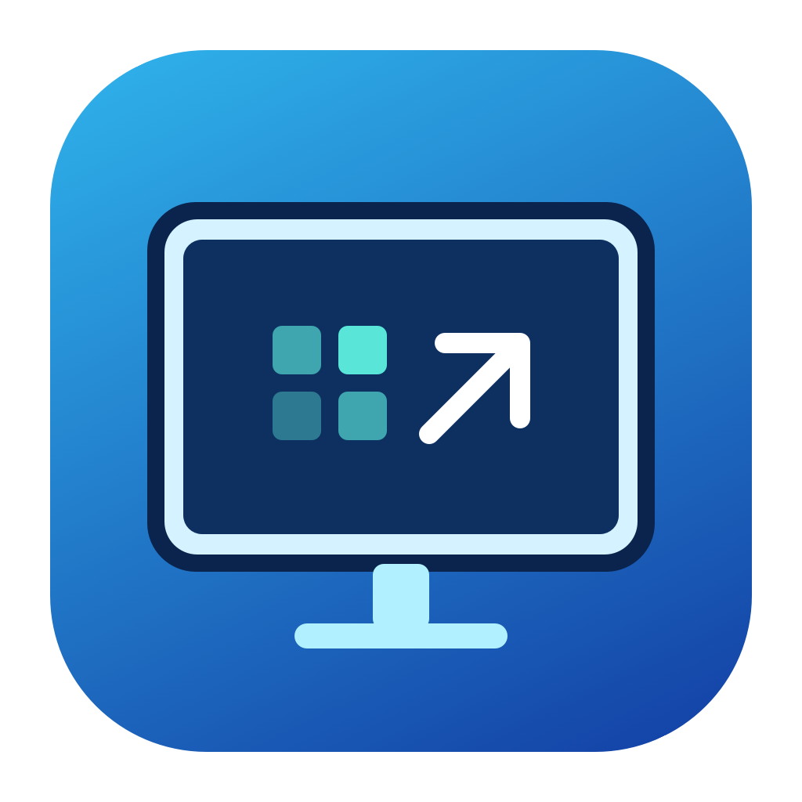

[English](README.md) | 简体中文

<p align="center"></p>
<h1 align="center">HiDPI Helper</h1>
<p align="center">让外接显示器的文字大小刚刚好。</p>

一款轻量的 macOS 菜单栏工具，用来切换 HiDPI 显示模式、生成独立显示配置，并在登录、唤醒或重新连接显示器后恢复已保存的模式。使用 Swift 和系统框架，无第三方运行时依赖。

## 功能

- 界面支持英文与简体中文，跟随系统首选语言；窗口底部可打开 GitHub 项目。
- 选择已连接的外接显示器，设置目标桌面宽高。
- 切换目标 HiDPI 模式；系统明确标记原生模式时可切回原生模式。
- 切换后 15 秒未确认自动恢复。
- 登录启动，以及登录、唤醒和重新连接后的模式恢复。
- 从零生成、安装和检查显示器覆盖配置，不依赖其他显示管理软件。
- 保留已有配置，安装前备份，安装后逐字节校验；可恢复安装前状态。
- 内置 DELL U2518D 的 2048 × 1152 预设，其他型号可自行输入目标尺寸。

## 兼容范围

需要 **macOS 13 或更新版本**。源码可分别在 Apple 芯片和 Intel Mac 上构建；发布包名称标明构建架构。

| 范围 | 状态 |
| --- | --- |
| 外接显示器枚举、选择与按厂商/型号生成配置 | 已实现 |
| 16:9、16:10、超宽屏尺寸的配置生成与回滚 | 已通过隔离测试 |
| DELL U2518D，2048 × 1152 HiDPI | 已通过实机安装、重启与自动恢复验证 |
| 其他显示器、接口、显卡或系统版本 | 需要自行验证，不能保证模式被系统接受 |
| 多显示器 | 可选择显示器并分别安装配置；自动恢复仅管理最后保存的一个显示器 |
| 内置显示器、虚拟显示器、EDID 修改、HDR 控制 | 不提供 |

HiDPI 配置按**厂商和型号**安装，会影响同型号显示器。自动恢复同时匹配硬件序列号；如果多台设备的这些标识完全一致，工具不会自动选择其中一台。

目标宽度允许 320–8192，高度允许 200–8192；这是输入范围，不是硬件能力承诺。建议保持显示器原生宽高比。更大的渲染尺寸会增加 GPU 与显存开销。

## 安装与使用

1. 从 [发布页面](https://github.com/jxlabx/HiDPIHelper/releases) 下载对应架构的压缩包，或按下方说明从源码构建。
2. 将 `HiDPI Helper.app` 放到「应用程序」目录，打开后选择外接显示器。
3. 输入希望显示的桌面尺寸，点击「保存目标尺寸」。如果修改了目标，自动恢复会关闭；确认新模式合适后再开启。
4. 点击「切换到 HiDPI」。若目标模式尚不存在，点击「创建 / 修复配置…」，在本机终端完成管理员验证。
5. 配置安装后保存工作并重启，重新打开应用、检查配置，再切换到目标模式并点击「保留设置」。
6. 按需开启「登录时启动」与自动恢复。

发布包采用临时签名，**未经 Apple 公证**。有签名或来源要求的环境应按自身策略使用；也可以在本机从源码构建。

关闭窗口后应用仍在菜单栏运行。需要退出时，点击菜单栏显示器图标中的「退出」。退出前未确认的切换会恢复。

应用启用登录启动后，请不要直接移动它。如需搬移，先取消登录启动，移动后重新启用。升级替换应用后，应重新检查登录项状态。

## 缩放原理

以 2560 × 1440 面板、2048 × 1152 目标桌面为例：

```text
2048 × 1152 桌面布局
        ↓ 2 倍像素精度绘制
4096 × 2304 渲染画面
        ↓ 系统缩放至面板
2560 × 1440 物理像素
```

文字和控件相当于放大 25%。HiDPI 使用更高精度绘制，仍涉及重采样，不能增加面板物理像素，也不保证与整数缩放同样锐利。

生成器仅请求指定的缩放模式，不修改 EDID。macOS 或硬件可能拒绝请求，因此**文件安装成功不等于模式已生效**，重启后须检查实际模式。

## 系统文件与恢复

配置文件：

```text
/Library/Displays/Contents/Resources/Overrides/DisplayVendorID-<厂商十六进制>/DisplayProductID-<型号十六进制>
```

安装备份和记录：

```text
/Library/Application Support/LocalHiDPIHelper/<厂商>-<型号>/
```

「恢复安装前配置…」恢复该型号最近一次实际安装前的状态。若此前没有文件，则将安装文件移入备份目录；不会永久删除备份。如果配置安装后被其他工具修改，恢复会停止，避免覆盖后续变更。恢复后需重启。

修改系统显示配置需要管理员验证。应用不保存管理员密码、不安装常驻管理员服务，也不自动关闭系统安全保护。不要让多个工具同时管理同一型号的显示配置。

## 从源码构建

安装 Xcode 命令行工具后，在项目目录运行：

```sh
./Scripts/test.sh
./Scripts/build.sh
```

默认构建当前架构；指定架构可运行 `BUILD_ARCH=arm64 ./Scripts/package.sh` 或 `BUILD_ARCH=x86_64 ./Scripts/package.sh`。

产物位于 `dist/HiDPI Helper.app`。构建不安装系统配置，不修改当前显示模式，也不注册登录项。

重新生成图标：

```sh
./Scripts/generate-icon.sh
```

图标由 `Assets/GenerateIcon.swift` 中的矢量路径绘制，包含从 16 像素到 1024 像素的尺寸。

## 命令行

应用内置 `ConfigTool`，读取明确的 JSON 配置：

```json
{
  "vendorID": 4268,
  "productID": 16700,
  "serialNumber": 0,
  "width": 2048,
  "height": 1152
}
```

```sh
APP='dist/HiDPI Helper.app'
"$APP/Contents/MacOS/ConfigTool" check profile.json
"$APP/Contents/MacOS/ConfigTool" generate profile.json display.plist
sudo "$APP/Contents/MacOS/ConfigTool" install profile.json
sudo "$APP/Contents/MacOS/ConfigTool" restore profile.json
"$APP/Contents/MacOS/HiDPIHelper" --diagnose
```

测试覆盖：不同厂商/型号和尺寸、空目录安装、重复安装、保留既有设置、回滚、异常输入、后续修改和符号链接。测试只写入项目构建目录，不写入系统配置。

## 项目结构

```text
Sources/App/          应用界面、模式切换与自动恢复
Sources/Core/         显示器配置规则、安装记录与系统模式读取
Sources/ConfigTool/   管理员配置操作入口
Tests/                隔离配置测试
Scripts/              构建、测试、图标与打包脚本
Resources/            应用元数据与图标
Assets/               图标源文件与预览
```

## 贡献与许可

欢迎通过 Issue 提交显示器型号、macOS 版本、芯片架构、连接方式及现象。提交日志前请移除序列号等个人信息。新增硬件实测记录应说明准确的环境和验证范围。

项目以 [MIT 许可证](LICENSE) 发布。
